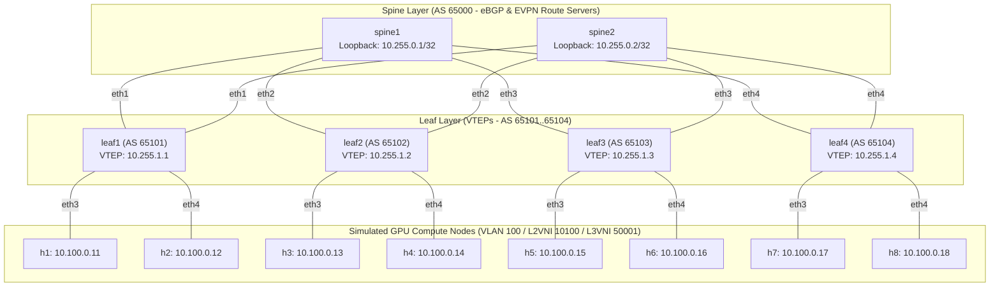

# AI Data Center Spine-Leaf Fabric and RoCEv2 Digital Twin

[](https://github.com/clos-lab-ai/actions/workflows/lint.yml)
[](LICENSE)

An automated, reproducible **AI Data Center Spine-Leaf Fabric Digital Twin** built with **Containerlab**, **FRRouting (FRR)**, and **Linux VXLAN/EVPN**, modeling the exact network architecture used by hyperscale colocation facilities and modern sovereign AI GPU clouds.

The platform provides a complete eBGP underlay (RFC 7938) with Equal-Cost Multi-Path (ECMP), a VXLAN BGP-EVPN overlay with symmetric Integrated Routing and Bridging (IRB) and distributed Anycast Gateways, connecting simulated GPU compute nodes. It features an automated east-west incast congestion benchmark showing how ECN marking and DCTCP alleviate buffer bloat and tail-latency under heavy all-to-one communication patterns.

---

## 1. Fabric Architecture



---

## 2. Technical Specifications

- **Underlay Routing:** eBGP (RFC 7938) with point-to-point `/31` links (`10.0.0.0/16`), 2-way ECMP multipath relaxation enabled across all leaves.
- **Overlay Routing:** VXLAN BGP-EVPN (RFC 8365).
  - **L2VNI 10100** mapped to VLAN 100 for Layer 2 extension across leaves.
  - **L3VNI 50001** and VRF `TENANT-A` with symmetric IRB and distributed Anycast Gateway (`10.100.0.1/24`, MAC `00:00:5e:00:01:01`).
  - Spines retain all route targets (`bgp retain-route-target all`) and act as EVPN Route Servers without local VTEPs.
- **MTU:** 9000 bytes (Jumbo frames) across fabric interconnects.
- **Declarative Topology:** The entire topology is generated from a single declarative source of truth: `topology/topology.yml`. Adding a leaf or host is a one-line change.

---

## 3. Quickstart

### Prerequisites & Target Environment
- **Red Hat Enterprise Linux 9** (or Rocky / AlmaLinux 9) running natively or in **VMware Workstation**. See detailed setup guide: [docs/vmware-rhel9-setup.md](docs/vmware-rhel9-setup.md).
- Alternatively: Linux (Ubuntu 22.04/24.04) or WSL2.
- Docker CE & Containerlab (`bash scripts/rhel_bootstrap.sh`).
- Python 3 with `jinja2` and `pyyaml`.

### Automated Setup & Commands
```bash
# 1. On fresh RHEL 9 VM: bootstrap Docker CE, Containerlab & kernel modules
make setup-rhel

# 2. Generate node and switch configurations
make generate

# 3. Deploy the 14-node fabric
make up

# 4. Check node status
make status

# 5. Verify underlay and overlay state
make verify

# 6. Run the incast benchmark
make benchmark

# 7. Tear down the fabric
make down
```

---

## 4. Repository Structure

```
clos-lab-ai/
├── .github/workflows/lint.yml     # Automated CI verification workflow
├── benchmarks/
│   ├── run_incast.sh              # 4:1 and 7:1 east-west incast test harness
│   ├── parse_results.py           # Metrics aggregator (iperf3, ping, qdisc)
│   └── plot_results.py            # Visualizer for throughput, drops, and p99 latency
├── configs/                       # Generated node configurations
├── docs/
│   ├── design-decisions.md        # Architecture justifications (eBGP, IRB, Anycast GW)
│   ├── lossless-roce.md           # PFC/ECN/DCQCN buffer physics & digital twin limits
│   ├── vendor-reference/          # Cumulus NVUE and SONiC lossless reference profiles
│   └── verification/              # Saved verification outputs (underlay.txt, overlay.txt)
├── results/                       # Benchmark raw JSON runs and generated plots
├── scripts/
│   ├── generate_configs.py        # Single-source Jinja2 topology generator
│   └── verify_fabric.sh           # Automated health & BGP/EVPN checker
├── templates/                     # Jinja2 configuration templates
├── topology/
│   ├── topology.yml               # Single Source of Truth
│   └── fabric.clab.yml            # Containerlab definition file
├── Makefile                       # Fabric lifecycle management
├── LICENSE                        # MIT License
└── README.md                      # Project documentation
```

---

## 5. Limitations (Digital Twin Boundary)

> [!IMPORTANT]
> **Data Plane Realism Boundary:**
> Virtual switches running in Linux containers or VMs do not possess hardware ASIC shared-memory packet buffers or silicon-level ingress admission thresholds.
> - **ECN & Active Queue Management:** Verified in dataplane via Linux `tc` (`red` / `tbf` / `fq_codel`) and end-host TCP congestion control (`dctcp` / `cubic`).
> - **Priority Flow Control (PFC) & Lossless RoCEv2:** PFC requires hardware MAC pause frames and ASIC ingress buffer memory headroom. Virtual containers cannot physically pause link transmission queues without hardware PHY/MAC support. **PFC and lossless RoCEv2 configurations are provided as production-grade, linted reference architectures for Cumulus Linux and SONiC, but are NOT claimed as dataplane-verified in software containers.**
